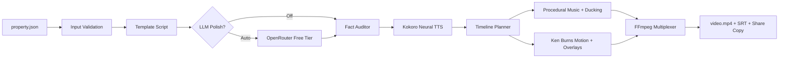

# Propvid: AI Property Video Generator

[](https://www.python.org/downloads/)
[](LICENSE)
[]()

**Propvid** is a deterministic-first, AI-polished video generation tool built for real estate developers and agencies. It transforms a structured property specification (`property.json`) and listing photos into professional, broadcast-ready 16:9 promotional videos (20–40 seconds) complete with neural voiceovers, dynamic Ken Burns motion, high-contrast overlay panels, royalty-free ambient music, synchronized SubRip captions, and social media copy.

---

## Key Features

- **Deterministic-First Foundation:** Generates complete, broadcast-quality videos with **zero LLM calls** and **zero network connectivity**. The deterministic generator produces 100% fact-accurate scripts every time.
- **Single-Request AI Polish:** When an OpenRouter API key is provided, an optional single-request AI polish uses free router models (`nvidia/nemotron-3.5-super-vl:free`, `google/gemma-4-31b-it:free`, `google/gemma-4-26b-a4b-it:free`) to refine narration for natural voiceover delivery.
- **Code-Based Hallucination Guardrails:** An automated fact auditor (`verify_scene`) verifies numbers, proper nouns, word counts, and banned buzzwords (`"cheapest"`, `"guaranteed"`). If an LLM hallucinates, **only the failing scene reverts to its deterministic template version**.
- **Offline Neural TTS (Kokoro ONNX):** Offline text-to-speech powered by the lightweight 82M Kokoro ONNX model (no PyTorch, no CUDA required). Supports direction-based pacing adjustments.
- **Procedural Ambient Soundtrack:** Pure NumPy mathematical synthesis of a lush 4-chord progression (Cmaj7-Am7-Fmaj7-G9) with automatic audio ducking during speech and 200ms smoothed transitions.
- **Indian Real Estate & Rupee Support:** Native handling of Lakh and Crore denominations (`₹1.25 Cr`), BHK designations (`3 BHK`), 24x7 timings, and verified Bitstream Vera/DejaVu Rupee glyph (`₹`) rendering.
- **Lightweight Dependencies:** Built without heavy frameworks: **No PyTorch, no MoviePy, no OpenCV, no ImageMagick, and no system FFmpeg install required**.

---

## Architecture Overview



For complete technical specifications, see [docs/architecture.md](docs/architecture.md).

---

## Installation

### Prerequisites
- Python 3.10 to 3.13 (Python 3.12 recommended)
- Linux, macOS, or Windows

### Setup
```bash
# Clone the repository
git clone https://github.com/pbsmarta/Realty_project.git
cd Realty_project

# Create and activate virtual environment
python3 -m venv .venv
source .venv/bin/activate  # On Windows: .venv\Scripts\activate

# Install core dependencies and TTS extras
pip install -r requirements.txt
pip install -r requirements-tts.txt
pip install -e .
```

### Environment Configuration (Optional)
```bash
cp .env.example .env
```
Populate your OpenRouter API key in `.env`:
```env
OPENROUTER_API_KEY=sk-or-v1-...
OPENROUTER_MODELS=nvidia/nemotron-3.5-super-vl:free,google/gemma-4-31b-it:free,google/gemma-4-26b-a4b-it:free
```

---

## CLI Usage

Propvid provides four intuitive CLI commands:

### 1. `doctor` — Environment Health Check
Inspects installed packages, FFmpeg binary, fonts, Rupee glyph geometry, model weights, and API connectivity:
```bash
propvid doctor
# With live API ping:
propvid doctor --ping
```

### 2. `init` — Create Property Specification
Interactively generate a valid property JSON:
```bash
propvid init -o my_listing.json
# Non-interactive with clean defaults:
propvid init -o my_listing.json --defaults
```

### 3. `validate` — Media & Schema Verification
Validates required fields, image accessibility, and resolution requirements:
```bash
propvid validate -i examples/property.sample.json
```

### 4. `make` — Video Generation
Renders video and exports accompanying artifacts:
```bash
# AI Polish + Neural TTS + Background Music + Auto-open
propvid make -i examples/property.sample.json -o out/sample --open

# 100% Offline Deterministic Mode (Zero LLM, Zero Network)
propvid make -i examples/property.sample.json -o out/sample_offline --llm off --tts none
```

#### CLI Options for `make`:
- `-i, --input PATH`: Path to input `property.json`.
- `-o, --out PATH`: Destination directory for exported artifacts.
- `--llm {auto,off,on}`: LLM script polish mode (default: `auto`).
- `--tts {auto,kokoro,fish,none}`: Audio voiceover backend (default: `auto`).
- `--res {720p,1080p}`: Output resolution (default: `720p`).
- `--music {synth,none,PATH}`: Background music track (default: `synth`).
- `--open`: Automatically open generated video in system media player.

---

## Output Artifacts

For each video generated, the output directory contains:
- **`video.mp4`**: 1280x720 24 fps H.264 video with AAC stereo audio.
- **`mix.wav`**: 44.1kHz 16-bit PCM master audio track.
- **`script.json`**: Scene timeline specification with headlines, captions, and voiceover text.
- **`captions.srt`**: Synchronized SubRip subtitles for accessibility.
- **`share_copy.txt`**: Fact-checked social media copy with hashtags ready for Instagram/LinkedIn.
- **`run_report.json`**: Detailed audit report containing input hash, model used, tokens, cache status, and render timings.

---

## Running the Test Suite

Run the full automated test suite (49 unit and integration tests):
```bash
pytest -v
```

---

## Licenses & Attributions

- **DejaVu / Bitstream Vera Fonts:** Permissive license. Included in `assets/fonts/` (see [assets/fonts/LICENSE.txt](assets/fonts/LICENSE.txt)).
- **Kokoro ONNX Model:** Apache 2.0 License by `@thewh1teagle` and Hexgrad.
- **Fish Audio:** Optional cloud TTS backend governed by Fish Audio Community License.
- **Demo Images:** Free-to-use photography from Pexels and Unsplash (see [examples/images/ATTRIBUTION.md](examples/images/ATTRIBUTION.md)).
