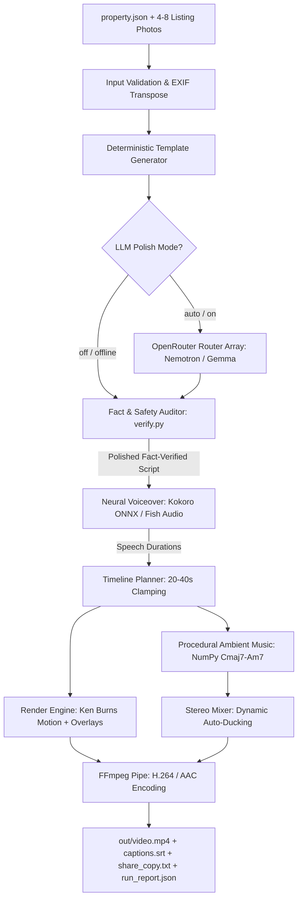

# Propvid: AI Property Video Generator
### Automated Real Estate Promotional Video Engine

[](https://www.python.org/downloads/)
[](LICENSE)
[]()
[]()

**Propvid** is a deterministic-first, AI-polished video creation tool built for real estate sales and marketing teams. It transforms raw property listing facts (`property.json`) and 4–8 photographs into broadcast-ready, professional 16:9 promotional videos (20–40 seconds) complete with neural voiceovers, dynamic Ken Burns camera motion, elegant typography panels, royalty-free ambient music, synchronized SubRip subtitles (`captions.srt`), fact-checked social media marketing copy (`share_copy.txt`), and execution audit reports (`run_report.json`)—all without opening a video editor.

---

## Business Problem & Relevance 

In real estate sales and brokerage:
- **The Bottleneck:** Sales agents take multiple listing photos on their phones and have basic property specs (price, BHK, amenities, location). However, creating a high-impact video reel for Instagram, LinkedIn, or WhatsApp currently requires manual editing in Premiere, After Effects, or Canva—taking **2 to 4 hours per listing**.
- **The Cost of Delay:** Properties that launch with video receive up to 400% more inquiries. When video production takes days, prime launch momentum is lost.
- **The Propvid Solution:** A sales agent or marketing coordinator can run a single interactive CLI command, input the property details and photo folder, and receive a broadcast-quality MP4 promotional video with narration, music, and social copy in **under 35 seconds**.

---

## AI / ML Approach & Quality Verification 

> *"If you use AI, explain what the AI does, what information it uses, and how you check its output."*

Propvid follows a strict **Deterministic-First Foundation**:

### 1. What the AI Does
- **Narration Polish:** An AI model is used as an optional polish layer to convert factual bullet points into natural, conversational voiceover copy tailored to the selected tone (`warm`, `premium`, `energetic`).
- **Single-Request Router Array:** Utilizes OpenRouter free models (`nvidia/nemotron-3.5-super-vl:free` primary, with automatic fallbacks to `google/gemma-4-31b-it:free` and `google/gemma-4-26b-a4b-it:free`).
- **Deterministic Disk Caching:** Responses are cached on disk by SHA-256 hash in `.cache/`. Re-runs are instantaneous and consume 0 tokens.

### 2. What Information the AI Uses
- The AI prompt receives **strictly the supplied listing facts**: property name, location, price, property type, tone, features, contact info, and scene camera directions.
- It receives **no external internet knowledge** and is instructed never to fabricate amenities, landmarks, or claims.

### 3. How Output is Checked (Code-Based Guardrails)
- **Facts Checked by Code, Not a Second LLM:** Rather than trusting a stochastic model to judge another model, Propvid uses a deterministic fact verifier (`verify_scene` in `src/propvid/scriptgen/verify.py`).
- **Auditing Logic:**
  - **Number Auditing:** Every number or denomination (`₹1.25 Cr`, `2 BHK`) in the narration must exist in the input facts.
  - **Proper Noun Auditing:** Unrecognized capitalized words not present in the input are rejected.
  - **Banned Buzzwords:** Anti-puffery filter rejects unsubstantiated claims (`"cheapest"`, `"guaranteed"`, `"best"`, `"rera approved"`).
  - **Length Clamping:** Voiceover narration is bounded to 22 words per scene to prevent speech overflow.
- **Per-Scene Graceful Rollback:** If the AI hallucinates on even a single scene, **only that specific scene reverts to its deterministic template version**. The rest of the valid polished scenes are preserved.

---

## Architecture & Data Flow



For complete technical specifications, see [docs/architecture.md](docs/architecture.md).

---

## What is Included in this Submission

- [x] **Working Runnable Prototype:** Full interactive CLI tool (`propvid`) with progress bars, health check, and instant preview.
- [x] **Source Code:** Modular, clean Python package under [`src/propvid/`](src/propvid/) (zero PyTorch, zero MoviePy, zero OpenCV).
- [x] **Sample Input Data:** 
  - [`examples/property.sample.json`](examples/property.sample.json) (standard 2-BHK listing)
  - [`examples/property.minimal.json`](examples/property.minimal.json) (minimal listing)
  - [`examples/property.broken.json`](examples/property.broken.json) (schema validation test)
  - [`examples/property.broken_images.json`](examples/property.broken_images.json) (corrupt image fallback test)
  - [`dataset/`](dataset/): 10 real houses with 40 photos across bedroom, bathroom, kitchen, and frontal exterior views.
- [x] **Sample Output:** Full production bundle committed under [`out/sample/`](out/sample/):
  - `video.mp4` (720p 24fps promotional video with speech and ambient music)
  - `mix.wav` (master audio track)
  - `script.json` (scene timeline)
  - `captions.srt` (SubRip subtitles)
  - `share_copy.txt` (Instagram / LinkedIn marketing copy)
  - `run_report.json` (execution audit log)
- [x] **Walkthrough & Demo Notes:** [`docs/demo-notes.md`](docs/demo-notes.md).
- [x] **AI Models, APIs & Libraries Note:** Full attribution in this README and [docs/architecture.md](docs/architecture.md).
- [x] **Anonymized Data:** Zero real customer PII; all contacts use synthetic placeholders (`Asha Rao`, `+91 90000 00000`).
- [x] **Automated Test Suite:** 54 unit and integration tests (`pytest -v`).

---

## Installation & Setup

### Prerequisites
- Python 3.10 to 3.13 (Python 3.12 recommended)
- Linux, macOS, or Windows

### Step-by-Step Setup
```bash
# 1. Clone repository
git clone https://github.com/pbsmarta/Realty_project.git
cd Realty_project

# 2. Create and activate virtual environment
python3 -m venv .venv
source .venv/bin/activate  # On Windows: .venv\Scripts\activate

# 3. Install core dependencies, TTS model runtime, and editable CLI
pip install -r requirements.txt
pip install -r requirements-tts.txt
pip install -e .

# 4. (Optional) Configure OpenRouter API Key for AI Polish
cp .env.example .env
```

Populate your `.env` (optional; Propvid works 100% offline without any API key):
```env
OPENROUTER_API_KEY=sk-or-v1-...
OPENROUTER_MODELS=nvidia/nemotron-3.5-super-vl:free,google/gemma-4-31b-it:free,google/gemma-4-26b-a4b-it:free
```

---

## How to Run the Solution

### 1. Interactive Video Studio (Recommended)
Simply run `propvid` without arguments in your terminal. It launches a guided interactive questionnaire:
```bash
propvid
```
You will be prompted for:
1. Property Name, Location, Price, and Property Type
2. Narration Tone (`warm`, `premium`, `energetic`)
3. Key Features (1–6 amenities)
4. Contact Info & Call to Action
5. Listing photos folder (e.g. `examples/images` or `dataset`)
6. Instant preview option (`--open`)

---

### 2. Batch / Direct Video Generation
Generate a video directly from an existing property specification:
```bash
# Ultra-fast rendering with Edge TTS (~2s speech synthesis):
propvid examples/property.sample.json -o out/sample --tts edge --open

# Local offline Kokoro TTS rendering:
propvid examples/property.sample.json -o out/sample_kokoro --tts kokoro --open

# Render any of the 10 real dataset houses with matched room photos:
propvid dataset/properties/house_1.json -o out/house_1 --tts edge --open

# 100% Offline Deterministic Mode (Zero LLM, Zero Network):
propvid examples/property.sample.json -o out/sample_offline --llm off --tts none
```

---

### 3. Environment Health Check (`propvid doctor`)
Run the diagnostic tool to verify Python runtime, FFmpeg binary, fonts, Rupee (`₹`) glyph geometry, and API connectivity:
```bash
propvid doctor
# With live OpenRouter ping:
propvid doctor --ping
```

---

### 4. Input Media Validation (`propvid validate`)
Validate property facts and test that all referenced photos exist and meet minimum resolution requirements ($\ge 640\times 360$ landscape or $\ge 300\times 450$ portrait):
```bash
propvid validate examples/property.sample.json
```

---

## Running the Test Suite

Run the complete 54-test automated test suite:
```bash
pytest -v
```

Tests cover:
- Pydantic schema validation & missing required fields
- EXIF auto-transposition for mobile photos
- Speech normalization (Rupee, Crore, Lakh, BHK, phone numbers)
- Ken Burns motion planning and 20–40s timeline constraints
- Procedural harmonic music synthesis & dynamic audio ducking
- Code-based fact verifier and hallucination rollback
- Offline fallback under simulated network partition

---

## External Services, AI Models & Libraries Used

| Component | Technology | Role / License |
|---|---|---|
| **Primary LLM** | `nvidia/nemotron-3.5-super-vl:free` | Single-request script polish via OpenRouter |
| **Fallback LLMs** | `google/gemma-4-31b-it:free`, `google/gemma-4-26b-a4b-it:free` | Router fallback within OpenRouter request |
| **Neural TTS** | Kokoro ONNX v1.0 (82M parameters) | High-speed offline neural speech synthesis (Apache 2.0) |
| **Cloud TTS (Opt)** | Fish Audio API | Optional cloud voiceover backend |
| **Audio Synthesis** | NumPy | Pure procedural trigonometric synthesis of Cmaj7-Am7 ambient score |
| **Video Encoding** | `imageio-ffmpeg` (FFmpeg v7.0.2) | Self-contained platform FFmpeg binary (zero system install) |
| **Image & Motion** | Pillow (PIL) | Ken Burns interpolation, alpha masks, RGBA overlays |
| **Validation** | Pydantic v2 | Strict schema enforcement with field error lists |
| **Typography** | DejaVu / Bitstream Vera | Permissive license; verified Indian Rupee glyph (`₹`) geometry |

---

## Limitations & Future Work

1. **2D Ken Burns vs. 3D Generative Video:** Transitions use smooth sub-pixel affine transformations on still photos rather than heavy 3D NeRF or generative video models (Runway/Sora), ensuring high speed (<35s render) and zero GPU requirements.
2. **16:9 Landscape Priority:** Layouts are currently tuned for widescreen presentations; vertical 9:16 layout support is architected and planned for mobile-first Instagram Reels.
3. **Single Voiceover Narrator:** Utilizes Kokoro's clear primary voice profile; conversational dialogue between multiple agents is not yet implemented.
