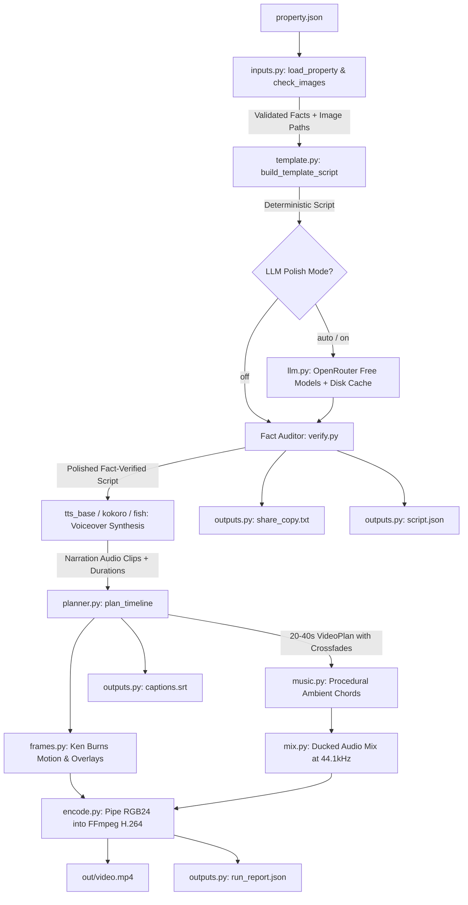

# System Architecture: Propvid Property Video Generator

`propvid` is an agentic, deterministic-first AI pipeline that compiles structured property listing specifications into broadcast-quality 16:9 vertical/horizontal promotional videos (20–40 seconds) accompanied by synchronized captions, voiceover narration, procedural ambient music, social share copy, and execution reports.

---

## 1. Core Principles

1. **Deterministic-First:**
   A complete, high-quality, 100% fact-compliant video is generated with zero LLM calls and zero external network access. The LLM is an optional polish layer, not a hard runtime dependency.
2. **At Most One LLM Request per Video:**
   When AI polish is active, a single completion request is sent to OpenRouter utilizing its router fallback array (`models: [...]`). Caching by deterministic SHA-256 hash ensures re-runs are instantaneous and free.
3. **Facts Checked by Code, Not by a Second Model:**
   A fast, deterministic fact auditor (`verify_scene`) verifies numbers, dates, proper nouns, and banned puffery phrases against ground truth input. Any scene failing verification reverts specifically to its deterministic template counterpart.
4. **Light Dependencies:**
   Zero heavy frameworks: No PyTorch, no MoviePy, no OpenCV, no ImageMagick, no system FFmpeg package requirements. Powered strictly by Python stdlib, Pydantic v2, Pillow, NumPy, imageio-ffmpeg, and ONNX Runtime.
5. **Clean Exit Codes & Graceful Audio Degradation:**
   - Exit code `0`: Success.
   - Exit code `2`: Input or schema validation error (`InputError`).
   - Exit code `3`: Video rendering or encoding failure (`RenderError`).
   - Exit code `4`: Unexpected exception (`PropvidError`).
   - Audio failures degrade smoothly to silent video mode with warnings, never crashing the render pipeline.

---

## 2. Pipeline Architecture & Data Flow

---

## 3. Component Breakdown

| Module | Responsibility | Key Design Choices |
| :--- | :--- | :--- |
| **`propvid.schema`** | Pydantic v2 data models & dataclasses | Strict validation, clean models: `PropertyInput`, `SceneSpec`, `Script`, `PlannedScene`, `VideoPlan`. |
| **`propvid.inputs`** | File loading & image sanitization | Resolves relative paths, validates EXIF orientations (`exif_transpose`), verifies min resolution ($\ge 640\times 360$ landscape or $\ge 300\times 450$ portrait). |
| **`propvid.scriptgen.template`** | Deterministic script generation | Fact-only natural grammar (e.g. natural lowercasing of features mid-sentence while preserving acronyms), direction mapping. |
| **`propvid.scriptgen.llm`** | Single-request OpenRouter polish | Router fallback models (`models[:3]`), reasoning control (`reasoning: {max_tokens: 0}`), tolerant JSON parser, disk caching in `.cache/`. |
| **`propvid.scriptgen.verify`** | Safety & factual accuracy auditor | Verifies numbers, proper nouns, word limits (22 words narration, 8-12 caption), and word-bounded banned phrases (`\bcheapest\b`, `\bbest\b`, `\brera\b`). |
| **`propvid.audio.tts_base`** | Acoustic text normalization | Speech-only acoustic normalization (`₹1.25 Cr` $\rightarrow$ `1.25 crore rupees`, `2-BHK` $\rightarrow$ `2 B H K`, `+91 ...` $\rightarrow$ spaced digits). Subtitles & overlays remain unmodified. |
| **`propvid.audio.tts_kokoro`** | Offline neural voice synthesis | Runs Kokoro 82M v1.0 ONNX model locally, direction-based pacing adjustment (`excited`: 1.05x, `calm`: 0.95x). |
| **`propvid.audio.tts_fish`** | Optional cloud neural voiceover | Fish Audio API client with automated audio caching and mono float32 decoding. |
| **`propvid.audio.music`** | Procedural background score | Pure NumPy ambient 4-chord progression (Cmaj7-Am7-Fmaj7-G9) with soft envelopes, chorus detuning, and 2s fadeouts. |
| **`propvid.audio.mix`** | Dynamic audio ducking & muxing | Resamples voiceover clips to 44.1kHz, places speech at `scene.start + 0.3s`, ducks background music to 12% during voiceover and 25% elsewhere with smooth 200ms ramps, peak-normalizes to -1.0 dB. |
| **`propvid.planner`** | Scene timeline & Ken Burns planning | Clamps scenes to $[3.5\text{s}, 7.0\text{s}]$ (or `speech_duration + 0.8s`). Enforces strict floor $\ge 20.0\text{s}$ (with target 21.0s margin) and ceiling $\le 40.0\text{s}$. Cycles camera motions (`zoom_in`, `zoom_out`, `pan_left`, `pan_right`). |
| **`propvid.render.text`** | Overlay typography & layout | High-contrast translucent dark panels with gold accent borders, responsive font sizing, word wrapping, and Rupee glyph mask verification. |
| **`propvid.render.frames`** | Motion, overlay blend, crossfades | Ken Burns camera crop with cosine ease-in-out, fade-in (0.4s) and fade-out (0.3s) overlay alpha, SIMD-accelerated crossfades via `Image.blend`. |
| **`propvid.render.encode`** | Atomic H.264 video encoding | Streams raw RGB24 frames to FFmpeg stdin, muxes AAC 44.1kHz audio, encodes using `libx264` (`yuv420p`, `crf 23`, `faststart`), atomically renames `.tmp.mp4` to `video.mp4`. |
| **`propvid.outputs`** | Artifact writers | Generates standard SubRip subtitles (`captions.srt`), verified social copy with hashtags (`share_copy.txt`), `script.json`, and execution metadata (`run_report.json`). |
| **`propvid.cli`** | Command-line interface | Subcommands: `validate`, `make`, `init`, `doctor`. Windows console CP1252 replacement safety, ASCII status indicators (`[OK]`, `[WARN]`, `[FAIL]`). |

---

## 4. Architectural Tradeoffs & Design Decisions

### Why Single-Request LLM with Router?
Sending multiple chat completions per video creates high latency, cost, and rate-limit risks. By combining the primary model (`nvidia/nemotron-3.5-super-vl:free`) and fallbacks (`google/gemma-4-31b-it:free`, `google/gemma-4-26b-a4b-it:free`) into a single OpenRouter request with disk caching, the system guarantees instant retries and zero provider lock-in.

### Why Two-Step Image Recognition (Filename + Vision LLM)?
Real estate listings frequently mix photos in arbitrary order (e.g., washroom, kitchen, bedroom, facade). If scenes are assigned images sequentially, a video might showcase a bathroom photo while speaking about the modular kitchen. Propvid solves this with a two-step recognition architecture:
1. **Step 1 (Deterministic Filename Classification):** Fast, zero-overhead regex/token parsing identifying canonical room types (`kitchen`, `bathroom`/`washroom`, `bedroom`, `living_room`, `dining_room`, `exterior`, `pool`, `parking`, `balcony`, `gym`).
2. **Step 2 (Vision LLM Fallback):** If photos have generic or random names (e.g. `IMG_0042.jpg`), Propvid automatically invokes OpenRouter Vision models (`nvidia/nemotron-3.5-super-vl:free` or `google/gemma-4-31b-it:free`) to classify the room from downscaled thumbnails, caching classifications by SHA-256 hash.
3. **Content-Aware Scene Matching:** Features match their corresponding room type (kitchen -> kitchen photo; frontal/exterior -> Title & CTA), with strict guardrails preventing bathroom photos from ever appearing during kitchen or living room voiceovers.

### Why Acoustic Normalization strictly for TTS?
Visual overlays and subtitles must show clean, professional shorthand like `"₹1.75 Cr"`, `"56 Cr"`, and `"3 BHK"`. If text normalization is applied globally, onscreen cards become verbose and cluttered. Propvid isolates text expansion strictly to the audio synthesis boundary:
- **Price Speech:** Normalized to natural spoken English (`1.75cr` -> `"one point 75 crores"`, `75l` -> `"75 lakhs"`, `2.5m` -> `"two point 5 millions"`, `1.2b` -> `"one point 2 billions"`, `50k` -> `"50 thousands"`). Decimals are cleanly pronounced as `"point"` with non-spaced digits.
- **BHK & Telephone:** `"5BHK"` -> `"5 B H K"`, telephone numbers grouped into paced digit blocks.

### Why Procedural Audio Synthesis?
Stock music tracks introduce licensing risks, copyright strikes on social media, and dependency on bundled audio assets. Propvid generates ambient harmonic soundscapes purely from mathematical trigonometric functions in NumPy, ensuring clean royalty-free audio for every video.

---

## 5. External Services, APIs, and AI Models Used

1. **AI Models & Router:**
   - **Primary LLM:** `nvidia/nemotron-3.5-super-vl:free` (OpenRouter API)
   - **Fallback LLMs:** `google/gemma-4-31b-it:free`, `google/gemma-4-26b-a4b-it:free`, `nvidia/nemotron-3-nano-omni-30b-a3b-reasoning:free` (OpenRouter API)
   - **Local Neural TTS Model:** Kokoro ONNX v1.0 (82M parameter lightweight transformer voice model; Apache 2.0 license)
   - **Cloud TTS Backend (Optional):** Fish Audio API (`https://api.fish.audio/v1/tts`)
2. **Third-Party Libraries:**
   - `pydantic` (v2): Strict input schema validation and error reporting
   - `pillow`: Image processing, EXIF orientation correction, RGBA text rendering, and alpha compositing
   - `numpy`: High-speed audio synthesis, procedural chord generation, and frame buffer manipulation
   - `imageio-ffmpeg`: Self-contained platform FFmpeg binary distribution (zero system install)
   - `httpx`: Non-blocking HTTP client for OpenRouter and Fish Audio APIs
   - `python-dotenv`: Environment variable configuration
   - `kokoro-onnx` & `soundfile`: Offline ONNX Runtime TTS inference and audio export
3. **Typography Assets:**
   - DejaVu / Bitstream Vera TrueType Fonts (`assets/fonts/`): Permissive license with native Rupee glyph (`₹`) support

---

## 6. System Limitations

1. **2D Ken Burns vs. 3D Camera Synthesis:**
   Motion is achieved through smooth, sub-pixel 2D affine transformations (zoom in/out, pan left/right) on high-resolution listing photos. It does not perform novel view synthesis (NeRF or 3D Gaussian splatting).
2. **Widescreen Landscape Orientation (16:9):**
   The layout engine is optimized for 1280x720 and 1920x1080 horizontal video presentations. Vertical 9:16 (Instagram Reels / TikTok) layouts can be generated by adjusting dimensions, but typography wrapping is currently optimized for widescreen panels.
3. **Single Voiceover Speaker:**
   Kokoro ONNX delivers high-clarity narration using its primary voice profile. Multi-speaker dialogue or conversational banter between multiple agents is not yet implemented.
4. **Initial TTS Model Download:**
   Although Kokoro runs 100% offline at runtime, the initial ~337MB ONNX model and voice weights must be downloaded once during environment setup via `python scripts/download_tts_models.py`.

